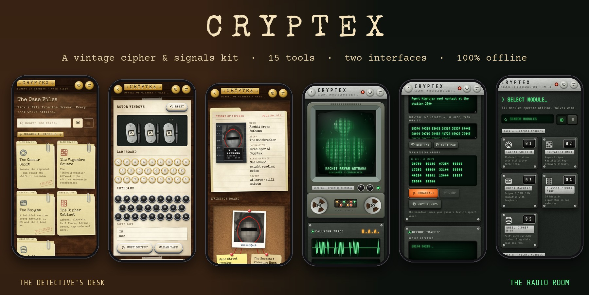
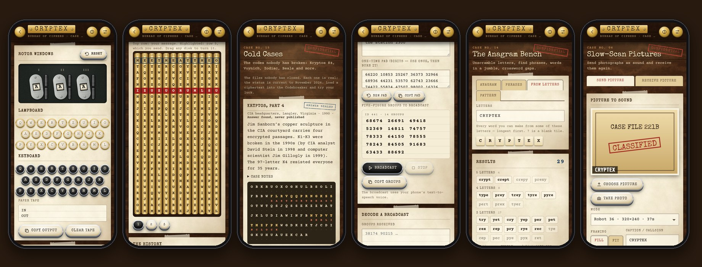
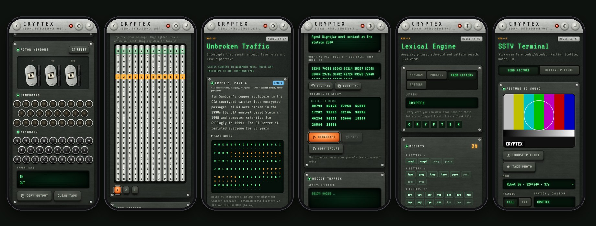

<div align="center">



# Cryptex

**A vintage cipher & signals kit for your phone.**
Break a Caesar shift, run the Enigma, send pictures as sound, broadcast like a Cold War numbers station —
all offline, in two hand-built interfaces.

[](https://github.com/aryan13rachit/cryptex/releases/latest/download/Cryptex.apk)
[](https://aryan13rachit.github.io/cryptex/)


</div>

---

## Two interfaces, one kit

| 🕵️ **The Detective's Desk** | 📻 **The Radio Room** |
|---|---|
| Manila case files on a walnut desk, typewriter keys, rubber stamps, a cork evidence board with red string. Every key strike sounds like a 1930s typewriter. | Bakelite and brushed aluminium, phosphor-green CRTs, Nixie readouts, relays clicking and a reel-to-reel tape bank. |

Switch at any time with the round button in the top bar.




## What's inside

### 🔐 Ciphers
| Tool | What it does |
|---|---|
| **Caesar Shift** | A draggable brass cipher wheel, ROT1/3/13, and a brute-force cracker that ranks all 26 shifts by how English they look. |
| **Vigenère Square** | Keyword and autokey modes, key alignment view, and automatic key recovery (Kasiski / index of coincidence / χ²). |
| **The Enigma** | Enigma I, M3 and the four-rotor U-boat M4 — rotors I–VIII, rings, plugboard, true double-stepping, a working lampboard. Ships with a real 1945 U-boat message to decrypt. |
| **Jefferson Wheel** *(new)* | Thomas Jefferson's 1795 cylinder of lettered disks (the US Army's M-94). The key is the disk order; drag disks, send any row — and in decode mode it finds the readable row for you. |
| **Cipher Cabinet** | Atbash, Affine, Rail Fence, Playfair, keyword substitution, Polybius, tap code, Bacon, A1Z26, ROT47 — and **Chaocipher** *(new)*, John Byrne's 1918 "unbreakable" machine whose method stayed secret until 2010. |

### 📡 Signals
| Tool | What it does |
|---|---|
| **Morse Telegraph** | Two-way translator, sounder, WAV export, a touch telegraph key, and a microphone decoder with auto-tune and auto-speed. |
| **Signal Lamp** | Light-beam Morse: transmit with the flashlight or the screen, receive with the camera. |
| **Slow-Scan Pictures** | A full SSTV encoder and decoder — Martin, Scottie, Robot and PD modes, VIS auto-detect, slant and dropout correction. Send a photo as sound; receive it again from the microphone. |
| **Sound Paper** | Record a sound, print it as a spectrogram, then scan the paper with the camera to hear it again. |
| **Numbers Station** *(new)* | Encode a message with a straddling checkerboard and a true one-time pad, then broadcast it like a Cold War spy station — interval chime, call-up, five-figure groups read aloud by a voice. Decode with your copy of the pad. |

### 🔎 Forensics
| Tool | What it does |
|---|---|
| **Codebreaker** | Letter-frequency chart against English, index of coincidence, a verdict on the likely cipher, and one-tap auto-solve. |
| **Anagram Bench** *(new)* | Exact anagrams, multi-word phrases (*dormitory → dirty room*), words from a jumble, and crossword patterns like `C?Y?T??` — over a 172,000-word dictionary, common words first. |
| **Cold Cases** *(new)* | The codes nobody has broken — Kryptos K4, the Voynich Manuscript, Zodiac Z13/Z32, the Beale ciphers, the Tamam Shud code, Dorabella, Shugborough and more — with history, current status, and one tap to load a ciphertext into the Codebreaker. |
| **Telegraph Office** | Base64, hex, binary, octal, decimal and URL encoding. |
| **Sealed Envelope** | Real AES-256-GCM encryption with a PBKDF2 password key, SHA hashes, and a password generator. |

Every button has its own synthesised, theme-matched sound and haptic tick — both can be switched off in Settings.

## Install

**Android** — download **[Cryptex.apk](https://github.com/aryan13rachit/cryptex/releases/latest/download/Cryptex.apk)** from the [latest release](https://github.com/aryan13rachit/cryptex/releases/latest), open it, and allow installs from your browser when Android asks. Updates install over the top and keep your settings.

**Any phone or computer** — open **[aryan13rachit.github.io/cryptex](https://aryan13rachit.github.io/cryptex/)** and choose *Install app* / *Add to Home screen* from the browser menu. It then works fully offline.

## Privacy

Cryptex has no accounts, no ads, no analytics and no network calls. Every cipher, decoder and dictionary runs on the device; camera and microphone are used only while you are using the tool that needs them.

## How it's built

```
cryptex/
├── index.html, css/, js/    the app itself — plain HTML, CSS and JavaScript modules, no framework
├── assets/                  fonts, generated textures, the dictionary
├── test/run-tests.js        71 checks
└── app/                     the Android app (Flutter)
```

The Android app is a native Flutter shell that serves the web code from its own bundle on `localhost`
and connects it to the phone: native haptics, the camera torch, the share sheet, text-to-speech,
the status bar and the back button. The same JavaScript runs in the browser and in the app.

```bash
node test/run-tests.js            # cipher vectors, Enigma (incl. the M4 U-534 message), SSTV round-trips,
                                  # Morse timing, Chaocipher, one-time pad, anagrams, Kryptos K4 clue positions
python -m http.server 8080        # run the web app locally → http://localhost:8080

cd app
python tool/sync_web.py           # copy the web app into the Flutter bundle
flutter build apk --release       # build the Android app
```

Release signing reads `app/android/keystore.properties` and the keystore it points to (both git-ignored).

## Credits

- **Dictionary:** [ENABLE](https://github.com/dolph/dictionary) word list (public domain), ranked by word frequency from [FrequencyWords](https://github.com/hermitdave/FrequencyWords) (MIT; OpenSubtitles data).
- **Fonts:** Special Elite (Apache 2.0), Courier Prime, VT323 and Share Tech Mono (SIL Open Font License).
- **Chaocipher** test vector from Moshe Rubin, *Chaocipher Revealed: The Algorithm* (2010).
- Textures are generated by `scripts/make-textures.py`; all sounds are synthesised in code.

<div align="center">
<br>
Made by <b>Rachit Aryan Asthana</b> — for everyone who grew up wanting a secret decoder ring.
</div>
